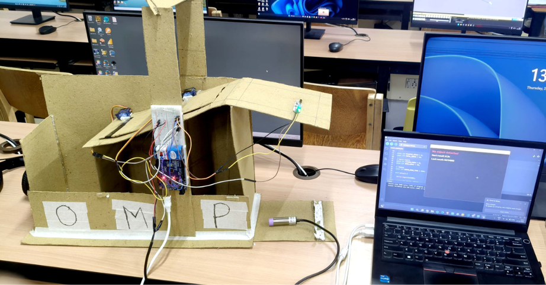
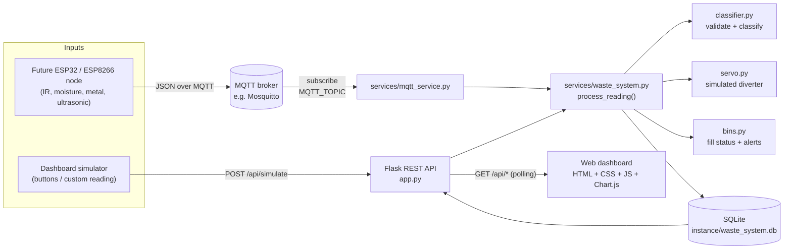
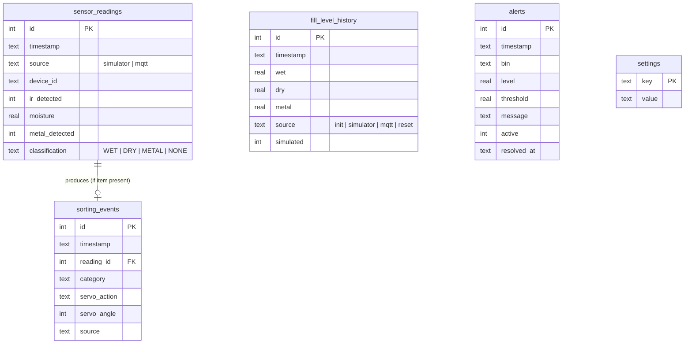

# IoT-Based Smart Waste Segregation and Monitoring System

A beginner-friendly IoT prototype that sorts waste into **wet**, **dry** and **metal** streams using three sensor inputs, drives a (simulated) servo diverter, monitors the fill level of three bins, and shows everything on a live web dashboard.

> [!IMPORTANT]
> **This repository (Version B) currently runs as a software simulation.** No physical sensors, servo motor or ultrasonic modules have been connected to this software or tested with it. Sensor readings come from a built-in simulator or from any MQTT publisher. The code is organised so that an ESP32/ESP8266 can later send real readings over MQTT without changes to the backend.

### Project versions

Our team first built a basic hardware version (Version A) that used image classification to sort items into paper, metal or organic. That build inspired this repository (Version B): a separate, software-based project that extends the idea with rule-based wet/dry/metal sorting, bin fill-level monitoring and a web dashboard. This repository contains only Version B.

| Version | What it is | Status |
|---------|------------|--------|
| **A: Physical prototype** (team build) | Basic cardboard sorter: an Arduino Uno moves servo flaps based on an image classifier running on a laptop | Physically built and demonstrated. See [Physical prototype (Version A)](#physical-prototype-version-a) |
| **B: This repository** | Software project inspired by Version A: Flask/SQLite/MQTT with rule-based wet/dry/metal sorting | Runs as a simulation. Not connected to hardware |

---

## Table of contents

1. [Problem statement and objectives](#problem-statement-and-objectives)
2. [Simulation vs. physical hardware](#simulation-vs-physical-hardware)
3. [Physical prototype (Version A)](#physical-prototype-version-a)
4. [Features](#features)
5. [System architecture](#system-architecture)
6. [Classification logic and limitations](#classification-logic-and-limitations)
7. [Hardware plan (future ESP32/ESP8266 build)](#hardware-plan-future-esp32esp8266-build)
8. [Software architecture](#software-architecture)
9. [Database design](#database-design)
10. [Setup on Windows (PowerShell)](#setup-on-windows-powershell)
11. [Running the app and the tests](#running-the-app-and-the-tests)
12. [MQTT integration](#mqtt-integration)
13. [REST API](#rest-api)
14. [Configuration reference](#configuration-reference)
15. [Screenshots](#screenshots)
16. [Limitations](#limitations)
17. [Future improvements](#future-improvements)

---

## Problem statement and objectives

Mixed waste is hard to recycle or compost. Separating it at the point of disposal makes downstream processing easier, but manual sorting is inconsistent, and bins that overflow before collection create hygiene problems.

**Objectives**

- Detect when an item is placed on the sorting platform (IR sensor).
- Separate it into wet, dry or metal using simple, explainable sensor rules (moisture + metal sensors).
- Actuate a servo diverter towards the correct bin.
- Monitor the fill level of each bin and raise an alert when a bin is nearly full.
- Log every reading, sorting event, fill-level change and alert, and present them on a web dashboard.
- Accept real sensor data over MQTT in future without rewriting the backend.

## Simulation vs. physical hardware

| Part | Current status |
|------|----------------|
| IR, moisture and metal sensors | **Simulated** (dashboard buttons / custom reading form) or received over MQTT |
| Servo diverter | **Simulated**: the target angle is calculated and logged; no motor is driven |
| Bin fill levels (ultrasonic) | **Simulated**: each sorted item adds a configurable percentage. An MQTT payload may report levels instead |
| MQTT input | Implemented and optional. Tested during development against a **local** broker on the same PC with the included test publisher (`tools/publish_test_reading.py`), including broker disconnection and reconnection. Not tested with a real microcontroller or any cloud broker |
| ESP32 firmware | A **reference sketch only** (`docs/firmware/`). Not compiled, flashed or tested |
| Physical prototype | **Not connected.** This software version has not been connected to any hardware, and no hardware measurements from it exist. The team's separate physical prototype is described in [Physical prototype (Version A)](#physical-prototype-version-a) |

The dashboard always shows a **SIMULATION MODE** badge, and the API reports `"physical_hardware_tested": false`. Both refer to this software version only.

## Physical prototype (Version A)

> This section describes the team's separate hardware build. None of the code in this repository ran on it.



Version A was a team project for **IoT & Embedded Systems (DIOT-05)**. It was a basic build that sorted items into paper, metal or organic using image classification. It was physically built and demonstrated, and it inspired the software-based project in this repository (Version B).

### Components

| Component | Purpose |
|-----------|---------|
| Arduino Uno on a breadboard | Reads the sensors and drives the servos |
| Two servo-driven flaps | Direct each item to its bin |
| IR sensor | Detects that an item is present |
| Cylindrical inductive proximity sensor | Detects metal |
| Laptop running a Python classifier (OpenCV + scikit-learn) | Classifies each item as paper, metal or organic |
| Laptop's built-in camera | Captures the image the classifier uses |
| Cardboard frame with three output bins | **O** (organic), **M** (metal), **P** (paper) |

### How an item is sorted

1. The IR sensor detects an item.
2. The laptop's built-in camera captures an image, and the Python classifier classifies the item as paper, metal or organic.
3. The laptop sends the result to the Arduino over USB serial (TODO: confirm the link and message format).
4. The Arduino moves the matching servo flap.
5. The item falls into the O, M or P bin.

TODO: confirm how the laptop learns that the IR sensor has detected an item, what the inductive sensor's reading was used for (sorting decisions came from image classification), and which flap positions send an item to each of the three bins.

### Team and roles

| Member | Role |
|--------|------|
| Priyangshu Dutta | TODO: add role |
| Akanshi Parihar | TODO: add role |
| Jothi Baskar | Built the hardware and wrote the Arduino firmware |

### Code

Code for this version will be added.

## Features

- Rule-based classifier with configurable moisture threshold and strict input validation.
- Simulated servo diverter with separate angles for wet, dry and metal bins.
- Fill-level monitoring for three bins with LOW / NORMAL / HIGH status.
- Configurable high-fill threshold (default **80 %**) and low-fill threshold (default 30 %).
- Alerts raised when a bin reaches the high threshold and resolved automatically when it is emptied.
- Web dashboard that refreshes every 3 seconds and immediately after every action:
  KPI tiles, current sensor reading, bin gauges, category chart, fill-level-over-time chart, alerts, activity table and MQTT status.
- Buttons to simulate wet, dry, metal and no-item detections, plus a custom-reading form.
- Threshold controls and bin-reset buttons for demonstrations.
- Optional MQTT subscriber (Paho MQTT) that feeds readings through the same logic.
- SQLite persistence and 45 automated tests (pytest).
- Works offline: Chart.js is bundled locally in `static/vendor/`.

## System architecture



Both input paths call the same `WasteSystem.process_reading()` method, so a reading from the simulator and a reading from a real device are validated, classified, stored and alerted on in exactly the same way.

## Classification logic and limitations

Each reading has three values:

| Field | Type | Meaning |
|-------|------|---------|
| `ir` | boolean (`true`/`false` or `1`/`0`) | An item is on the platform |
| `moisture` | number, 0 to 100 | Normalised moisture percentage |
| `metal` | boolean (`true`/`false` or `1`/`0`) | The metal (inductive) sensor triggered |

Rules are applied in priority order:

```text
1. ir == false               -> NONE   (no sorting operation, servo does not move)
2. metal == true             -> METAL
3. moisture > threshold      -> WET    (default threshold 60 %, configurable)
4. otherwise                 -> DRY
```

Invalid readings are rejected with an explanation: missing fields, non-boolean `ir`/`metal`, non-numeric, NaN or out-of-range `moisture`, unknown bins in `fill`, and so on.

**Limitations of this logic.** This is simplified educational logic, *not* a universal waste-classification method:

- Mixed items (a damp paper cup, foil-lined packaging, food in a metal tin) cannot be described by one moisture value and one metal flag.
- A capacitive or resistive moisture probe only measures what it touches; surface moisture may not represent the whole item.
- Inductive sensors detect metal only at short range (a few millimetres) and respond differently to ferrous and non-ferrous metals.
- Plastics, glass, e-waste and hazardous waste are not distinguished. They would all be sorted as "dry".
- The moisture threshold has to be calibrated against real sensors; the default of 60 % is a placeholder, not a measured value.

## Hardware plan (future ESP32/ESP8266 build)

> Nothing in this section has been built or tested. It is a proposed design for the next stage of the project.

### Proposed components

| Component | Example part | Purpose |
|-----------|--------------|---------|
| Microcontroller | ESP32 DevKit V1 (preferred) or NodeMCU ESP8266 | Reads sensors, publishes MQTT |
| IR obstacle sensor | FC-51 or similar | Detect item presence |
| Moisture sensor | Capacitive soil-moisture sensor v1.2 | Estimate wetness |
| Metal sensor | LJ12A3-4-Z/BX inductive proximity sensor (NPN) | Detect metal |
| Servo motor | MG996R (or SG90 for a light flap) | Diverter flap |
| Ultrasonic sensors ×3 | HC-SR04 | Bin fill level |
| Power | 5 V 2 A+ supply for the servo, separate from USB | Prevent brown-outs |
| Level shifting | Voltage dividers / optocoupler | Protect 3.3 V GPIO |

### Proposed ESP32 pin mapping

| Signal | ESP32 GPIO | Notes |
|--------|-----------|-------|
| IR sensor OUT | GPIO 27 | Digital input, active LOW on most modules |
| Metal sensor OUT | GPIO 26 | Through an optocoupler or divider. The LJ12A3 runs at 6 to 36 V |
| Moisture AOUT | GPIO 34 | ADC1 (works while Wi-Fi is active), input-only pin |
| Servo signal | GPIO 13 | Servo powered from a separate 5 V supply, common ground |
| Ultrasonic wet TRIG / ECHO | GPIO 25 / GPIO 18 | ECHO is 5 V. Use a divider (e.g. 1 kΩ / 2 kΩ) |
| Ultrasonic dry TRIG / ECHO | GPIO 32 / GPIO 19 | Same divider on ECHO |
| Ultrasonic metal TRIG / ECHO | GPIO 33 / GPIO 21 | Same divider on ECHO |

### Proposed ESP8266 (NodeMCU) pin mapping

The ESP8266 has fewer usable pins and only one analog input, so this is a reduced design:

| Signal | NodeMCU pin | Notes |
|--------|-------------|-------|
| IR sensor OUT | D5 (GPIO 14) | |
| Metal sensor OUT | D6 (GPIO 12) | Via optocoupler / divider |
| Moisture AOUT | A0 | The only ADC. The NodeMCU board scales 0 to 3.3 V |
| Servo signal | D7 (GPIO 13) | External 5 V servo supply |
| Ultrasonic TRIG / ECHO | D1 (GPIO 5) / D2 (GPIO 4) | One sensor only. More bins need an I/O expander or time-multiplexing |

A reference ESP32 sketch that publishes the JSON payload format used by this project is in [`docs/firmware/esp32_waste_node/esp32_waste_node.ino`](docs/firmware/esp32_waste_node/esp32_waste_node.ino). It is **untested**. Treat it as a starting point and expect to debug and calibrate it.

## Software architecture

```text
app.py                     Flask app factory, REST endpoints, error handlers
config.py                  All settings, overridable by environment variables
requirements.txt
pytest.ini
models/
  database.py              SQLite schema and queries (one connection per operation)
services/
  classifier.py            Sensor validation + rule-based classification
  servo.py                 Simulated servo diverter
  bins.py                  Fill status (LOW/NORMAL/HIGH) and fill payload validation
  waste_system.py          Orchestrates classify -> servo -> bins -> alerts -> storage
  simulator.py             Generates simulated readings for the demo buttons
  mqtt_service.py          Optional Paho MQTT subscriber
templates/index.html       Dashboard markup
static/css/style.css       Dashboard styles (light + dark)
static/js/dashboard.js     Polling, actions, charts (vanilla JS)
static/vendor/             Chart.js 4.4.1 (MIT licence), bundled for offline use
tools/publish_test_reading.py  Publishes a test reading over MQTT (stands in for a device)
tests/                     pytest suite
docs/firmware/             Untested ESP32 reference sketch
docs/screenshots/          Placeholder folder for real screenshots
```

**Processing one reading**

1. Validate the raw JSON (`classifier.parse_reading`).
2. Classify it with the current moisture threshold.
3. Ask the simulated servo for the target angle (or "no action" when no item is present).
4. Store the reading, plus a sorting event if an item was sorted.
5. Update bin fill levels: add the simulated increment, or use device-reported levels if the payload contains `fill`.
6. Raise a HIGH-fill alert if a bin has reached the threshold and has no active alert; resolve alerts for bins that have dropped below it.

## Database design

SQLite file: `instance/waste_system.db`, created automatically and ignored by git.



Timestamps are stored in UTC (ISO 8601) and displayed in the browser's local time.

## Setup on Windows (PowerShell)

Requirements: **Python 3.11 or newer** ([python.org](https://www.python.org/downloads/)) and Git.

```powershell
# 1. Get the code
git clone https://github.com/<your-username>/<your-repo>.git
cd <your-repo>

# 2. Create a virtual environment in the project folder
py -3 -m venv .venv

# 3. Activate it
.\.venv\Scripts\Activate.ps1
```

If PowerShell refuses to run the activation script ("running scripts is disabled on this system"), allow local scripts for your user once and try again:

```powershell
Set-ExecutionPolicy -Scope CurrentUser -ExecutionPolicy RemoteSigned
.\.venv\Scripts\Activate.ps1
```

```powershell
# 4. Install dependencies
python -m pip install --upgrade pip
pip install -r requirements.txt
```

## Running the app and the tests

```powershell
# Start the dashboard (simulation mode, MQTT disabled)
python app.py
```

Open <http://127.0.0.1:5000> in a browser. Click **Wet waste**, **Dry waste**, **Metal waste** or **No item** and watch the dashboard update. Stop the server with `Ctrl+C`.

```powershell
# Run the automated tests
python -m pytest
```

To start again with an empty history, stop the app and delete the database:

```powershell
Remove-Item .\instance\waste_system.db
```

## MQTT integration

MQTT is **optional and disabled by default**. The simulator and dashboard work without a broker. If MQTT is enabled but the broker is unreachable or drops, the app keeps running, the badge shows *connecting* / *disconnected*, and Paho retries automatically (1 to 30 s back-off).

### Payload format

Publish UTF-8 JSON (max 2 KB) to the configured topic (default `smartwaste/sensors`):

```json
{
  "device_id": "esp32-node-01",
  "ir": true,
  "moisture": 63.2,
  "metal": false,
  "fill": { "wet": 42.0, "dry": 18.5, "metal": 7.0 }
}
```

| Field | Required | Notes |
|-------|----------|-------|
| `ir` | yes | `true`/`false` or `1`/`0` |
| `moisture` | yes | 0 to 100 |
| `metal` | yes | `true`/`false` or `1`/`0` |
| `device_id` | no | String, max 64 characters |
| `fill` | no | Measured bin levels (0 to 100). Any subset of `wet`, `dry`, `metal`. When present these replace the simulated increment |

Invalid payloads are rejected and counted on the dashboard. They never crash the subscriber.

### Testing with a local broker (Mosquitto)

1. Install Eclipse Mosquitto for Windows from <https://mosquitto.org/download/>. By default it listens on `localhost:1883`.
2. Start the broker in one PowerShell window:

   ```powershell
   & "C:\Program Files\mosquitto\mosquitto.exe" -v
   ```

3. In a second window, start the dashboard with MQTT enabled:

   ```powershell
   .\.venv\Scripts\Activate.ps1
   $env:MQTT_ENABLED = "true"
   $env:MQTT_BROKER_HOST = "localhost"
   $env:MQTT_BROKER_PORT = "1883"
   $env:MQTT_TOPIC = "smartwaste/sensors"
   python app.py
   ```

4. In a third window, publish test readings with the included tool (no hardware needed):

   ```powershell
   .\.venv\Scripts\Activate.ps1
   python tools/publish_test_reading.py --type wet
   python tools/publish_test_reading.py --type metal --device-id bench-test
   python tools/publish_test_reading.py --ir 1 --moisture 35 --metal 0 --fill-dry 85
   ```

   Or with Mosquitto's own client (quoting shown for Windows PowerShell 5.1; the included Python tool avoids quoting issues entirely):

   ```powershell
   & "C:\Program Files\mosquitto\mosquitto_pub.exe" -h localhost -t smartwaste/sensors -m '{\"device_id\":\"cli\",\"ir\":true,\"moisture\":72,\"metal\":false}'
   ```

The MQTT badge should show **connected** and the readings appear in the activity table with source *MQTT*.

### Credentials

Set `MQTT_USERNAME` and `MQTT_PASSWORD` as environment variables in your shell session. They are never stored in the code or database. `.env` files are listed in `.gitignore`. Plain MQTT on port 1883 is unencrypted, so use it only on a trusted local network. TLS is listed under future improvements.

## REST API

All responses are JSON. Errors look like `{"error": "...", "details": ["..."]}` with HTTP 400, 404 or 405.

| Method | Endpoint | Description |
|--------|----------|-------------|
| GET | `/api/status` | Totals, per-category counts, bin levels and statuses, latest reading, thresholds, servo, MQTT state, mode |
| GET | `/api/events?limit=20` | Recent sorting events, newest first (`limit` 1 to 500) |
| GET | `/api/fill-levels?limit=50` | Current levels, thresholds and fill-level history (oldest first) |
| GET | `/api/alerts?limit=50&active=true` | Active alerts and alert history |
| POST | `/api/simulate` | Process a simulated reading |
| POST | `/api/reset` | Reset bin levels to 0 % and resolve their alerts |
| GET | `/api/settings` | Current thresholds |
| PUT/POST | `/api/settings` | Update thresholds |

**`POST /api/simulate`**: either a preset scenario or a custom reading:

```json
{ "type": "wet" }
```

```json
{ "reading": { "ir": true, "moisture": 72.5, "metal": false } }
```

`type` is one of `wet`, `dry`, `metal`, `none`. The response is `201` when an item was sorted and `200` for no-item readings:

```json
{
  "classification": "WET",
  "sorted": true,
  "reading": { "ir_detected": true, "moisture": 72.5, "metal_detected": false, "device_id": "simulator" },
  "servo": { "action": "ROTATE_TO_WET", "from_angle": 0, "target_angle": 45, "description": "..." },
  "source": "simulator",
  "timestamp": "2026-01-01T10:00:00Z",
  "event_id": 12,
  "fill_levels": { "wet": { "level": 15.0, "status": "LOW" }, "...": "..." },
  "new_alerts": []
}
```

**`POST /api/reset`**: `{}` resets all bins and `{"bin": "wet"}` resets one.

**`PUT /api/settings`**: any subset of:

```json
{ "moisture_threshold": 55, "fill_low_threshold": 25, "fill_high_threshold": 85, "fill_increment": 5 }
```

All values must be 0 to 100, the low threshold must be below the high threshold, and the increment must be greater than 0. Settings are saved in the database and survive restarts.

PowerShell example:

```powershell
Invoke-RestMethod -Method Post -Uri http://127.0.0.1:5000/api/simulate -ContentType "application/json" -Body '{"type":"metal"}'
Invoke-RestMethod http://127.0.0.1:5000/api/status
```

## Configuration reference

Set these as environment variables before `python app.py` (PowerShell: `$env:NAME = "value"`). Thresholds can also be changed later from the dashboard. Values saved there take precedence over the environment defaults.

| Variable | Default | Description |
|----------|---------|-------------|
| `APP_HOST` / `APP_PORT` | `127.0.0.1` / `5000` | Web server address |
| `APP_DEBUG` | `false` | Flask debug mode |
| `DATABASE_PATH` | `instance/waste_system.db` | SQLite file |
| `MOISTURE_THRESHOLD` | `60` | Moisture % above which an item is WET |
| `FILL_LOW_THRESHOLD` | `30` | Below this a bin is LOW |
| `FILL_HIGH_THRESHOLD` | `80` | At or above this a bin is HIGH and alerts |
| `FILL_INCREMENT` | `5` | Simulated % added per sorted item |
| `SERVO_ANGLE_WET` / `_DRY` / `_METAL` / `_IDLE` | `45` / `90` / `135` / `0` | Simulated servo angles (0 to 180) |
| `MQTT_ENABLED` | `false` | Turn on the MQTT subscriber |
| `MQTT_BROKER_HOST` / `MQTT_BROKER_PORT` | `localhost` / `1883` | Broker address |
| `MQTT_TOPIC` | `smartwaste/sensors` | Topic to subscribe to |
| `MQTT_USERNAME` / `MQTT_PASSWORD` | *(unset)* | Optional broker credentials |
| `MQTT_CLIENT_ID` | `smart-waste-dashboard` | Client ID |

## Screenshots

> **Placeholders.** No screenshots have been added yet. Run the app, capture your own, save them in [`docs/screenshots/`](docs/screenshots/), and replace the placeholders below.

| View | Screenshot |
|------|------------|
| Dashboard overview | *Placeholder: `docs/screenshots/dashboard-overview.png`* |
| High-fill alert | *Placeholder: `docs/screenshots/fill-alert.png`* |
| MQTT connected | *Placeholder: `docs/screenshots/mqtt-connected.png`* |
| Physical prototype | Not applicable to this software version. A photo of the separate Version A build is in [Physical prototype (Version A)](#physical-prototype-version-a) |

## Limitations

- **No physical hardware has been connected or tested.** All sensor values, servo motion and (by default) bin levels are simulated.
- The classifier uses three simple rules and cannot handle mixed or multi-material waste (see [Classification logic and limitations](#classification-logic-and-limitations)).
- Simulated fill levels rise by a fixed amount per item. Real bins fill by volume, not by item count.
- The dashboard has no user accounts or authentication. Run it only on `127.0.0.1` or a trusted local network.
- MQTT runs without TLS. The servo is not commanded over MQTT; the reference firmware moves its own servo locally.
- Flask's built-in server is for development and demonstration, not production.
- The dashboard polls every 3 seconds rather than using push updates.

## Future improvements

- Build the hardware prototype and calibrate the moisture threshold and ultrasonic bin depth with real measurements.
- Compile, flash and debug the ESP32 reference sketch. Add an ESP8266 variant.
- Publish servo commands from the server on a command topic, as an alternative to on-device decisions.
- MQTT over TLS and per-device credentials.
- Device heartbeat / last-seen monitoring and offline-device alerts.
- Export of history to CSV.
- Server-sent events for instant dashboard updates.
- Collection-route notifications when bins reach the high threshold.

---

*Educational prototype. The classification rules are simplified and not suitable for real-world waste-management decisions without calibration and validation on physical hardware.*
